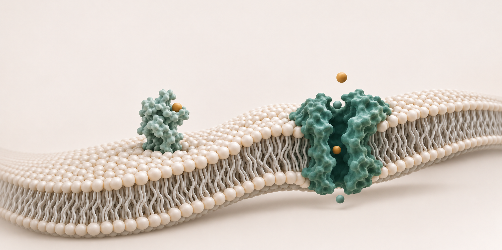

<section class="opening" aria-labelledby="hero-title">

<h1 id="hero-title">Molecular<em>biomimetics.</em></h1>

<canvas id="titleCanvas" data-autoplay="true" aria-label="Animated CMBL molecular wordmark">CMBL</canvas>
</section>
<section class="shell home-research" id="research">
<h2>Research</h2><a class="plain-link" href="/research/">Research overview ↗</a>
<button type="button" data-topic-direction="-1" aria-label="Previous research topics" aria-controls="home-research-topics">←</button><button type="button" data-topic-direction="1" aria-label="Next research topics" aria-controls="home-research-topics">→</button>

<article class="topic-preview"><h3><a href="/research/#ionic-memory">Ionic Neuromorphic Computing</a></h3>
History-dependent ion transport and synaptic-like responses.
</article><article class="topic-preview"><h3><a href="/research/#selective-transport">Molecular Separation</a></h3>
Pore chemistry and membrane motion in selective transport.
</article><article class="topic-preview"><h3><a href="/research/#interfacial-recognition">Interfacial Molecular Recognition</a></h3>
Molecular interactions at the electrode–solution interface.
</article><article class="topic-preview"><h3><a href="/research/#researcher-directed-automation">AI/ML Automation</a></h3>
Reducing simulation workload while preserving scientific judgment.
</article>

</section>

<section class="person-section">

PRINCIPAL INVESTIGATOR
<h2>Yechan Noh</h2>
Provost’s Postdoctoral Fellow University of Notre Dame

Before joining Notre Dame, Yechan was a postdoctoral researcher at the National Institute of Standards and Technology. He received his Ph.D. in Mechanical Engineering from the University of Illinois Urbana-Champaign.
<a class="text-link" href="/people/">Biography & appointments↗</a>

</section><section class="news-section">
<h2>Latest news</h2><a class="text-link" href="/news/">All news↗</a>
<a class="news-row" href="{{ item.url | relative_url }}"><time datetime="{{ item.date | date: '%Y-%m-%d' }}">{{ item.date | date: '%b %Y' }}{{ item.date | date: '%b %-d, %Y' }}</time><h3>{{ item.title }}</h3>↗</a></section>

